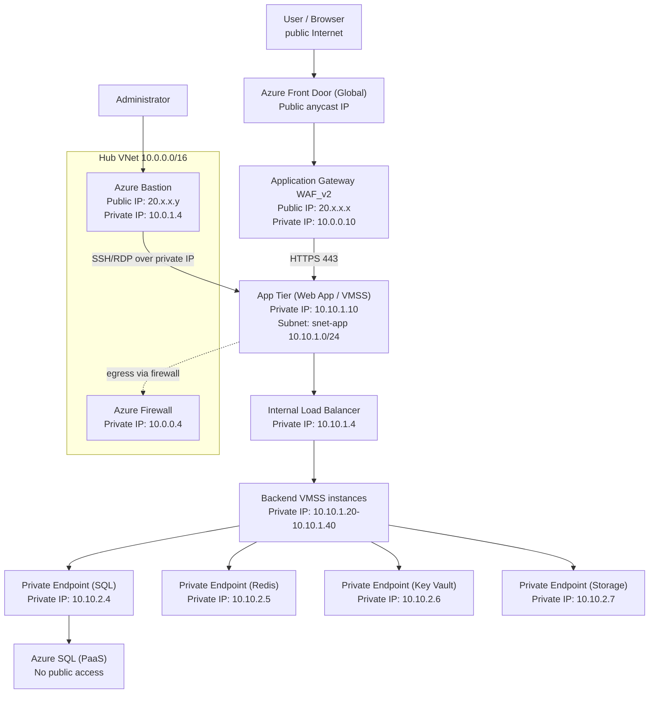

# Crocus — Enterprise Azure Landing Zone (Terraform)

Crocus is a modular, multi-environment Azure Landing Zone built with Terraform. It deploys **1 Hub + N Spokes**, with HA, backup, DR, monitoring, and one-click deployment. It is designed so **any 3-tier monolithic application** (Presentation / Application / Data) can run on top of it without changing the infrastructure code.

> **You could not view the attached image in this session**, so the IP flow below uses the real subnets defined in this repo (Hub `10.0.0.0/16`, Spoke `10.10.0.0/16`). Replace the example IPs with your deployed outputs if they differ.

## 1. What gets deployed

- `scripts/` — one-click deployer + tfstate snapshot
- `policies/opa/` — OPA guardrails (deny public endpoints, protect stateful prod)
- `modules/` — 17 atomic child modules (5 files each)
- `environments/{prod,preprod,uat,test}/` — 4 isolated root stacks × 4 layers

Layers (run in order):

1. `01-management-and-monitoring` — Log Analytics, App Insights, Sentinel, Key Vault
2. `02-connectivity-hub` — Hub VNet, Firewall, Bastion, Private DNS
3. `03-monolith-spokes` — dynamically deploys `erp-core`, `billing-suite`, `customer-portal` spokes (primary + DR via `flatten()`)
4. `04-global-edge-and-dr` — App Gateway WAF, Front Door, Backup Vault, SQL Failover Group

## 2. Traffic flow (how a user request travels)



### IP / subnet plan

| Component | Subnet / IP | Notes |
|---|---|---|
| Hub VNet | `10.0.0.0/16` | Shared connectivity |
| AzureFirewallSubnet | `10.0.0.0/26` | Firewall private IP `10.0.0.4` |
| AzureBastionSubnet | `10.0.1.0/26` | Bastion private IP `10.0.1.4` |
| Spoke VNet | `10.10.0.0/16` | Per-monolith spoke |
| snet-app | `10.10.1.0/24` | App tier (web apps / VMSS) |
| snet-db | `10.10.2.0/24` | Private endpoints for SQL/Redis/KV/Storage |
| SQL private endpoint | `10.10.2.4` | No public SQL endpoint |
| Redis private endpoint | `10.10.2.5` | |
| Key Vault private endpoint | `10.10.2.6` | |
| Storage private endpoint | `10.10.2.7` | |

### Security rules (NSGs are boundaries, not hops)

```
Internet -> App Gateway -> (Frontend NSG) -> App Tier -> (Backend NSG) -> Data tier -> (Data NSG) -> Private Endpoints -> Azure SQL
```

- Only **2 public IPs** exist: App Gateway + Bastion.
- No public IP on VMs, ILB, SQL, Redis, Storage, Key Vault.
- All data access is over private endpoints + private DNS zones.

## 3. Step-by-step: run ANY 3-tier monolithic app on this infra

### Step 0 — Prerequisites

1. Azure subscription + `az login`.
2. Terraform >= 1.10 installed.
3. A resource group + storage account for tfstate (see `backend.tf`).

### Step 1 — Deploy the landing zone

```bash
./scripts/deploy-one-click.sh prod
```

This runs layers 01 → 04 in order. Wait for completion (≈ 20–40 min).

### Step 2 — Map your 3 tiers to the infra

| Your app tier | Where it runs in Crocus | Module used |
|---|---|---|
| **Presentation (UI / web)** | Azure App Service (or VMSS) in spoke `snet-app` | `compute-app-service` / `compute-vmss` |
| **Application (business logic)** | Same app tier (monolith) OR separate VMSS pool behind ILB | `compute-app-service` / `compute-vmss` + `lb` |
| **Data (DB / cache / files)** | Azure SQL + Redis + Storage via private endpoints | `database-sql` / `database-postgres` + `redis-cache` + `storage-account` + `private-endpoint` |

### Step 3 — Configure the app (no secrets in code)

1. Create a Key Vault secret for your DB password (or use the ephemeral one generated by `database-sql`).
2. Grant the web app a **System-assigned Managed Identity**.
3. Give that identity `Key Vault Secrets User` on the vault.
4. In App Service → Configuration, add:
   - `SQL_CONNECTION_STRING` = `Server=tcp:<sql-fqdn>,1433;Database=appdb;...` (FQDN from `database-sql` output `server_fqdn`)
   - `REDIS_HOST` = output of `redis-cache` (`hostname`)
   - `STORAGE_ACCOUNT` = output of `storage-account` (`name`)

### Step 4 — Connect networking (private only)

1. Peer spoke VNet ↔ hub VNet (already wired via `networking-vnet` peering inputs).
2. Create `private-endpoint` for SQL/Redis/KV/Storage in `snet-db`, linked to the `private-dns` zones.
3. Set App Service **VNet integration** to `snet-app` so outbound traffic stays private.
4. Route egress through the Firewall (UDRs) — default `Deny` on NSGs.

### Step 5 — Deploy your application code

```bash
# Example: deploy a containerized monolith to App Service
az webapp config container set --name app-erp-core-prod --resource-group rg-spoke-erp-core-prod \
  --docker-custom-image-name myregistry.azurecr.io/monolith:latest
```

Or push code via GitHub Actions / Azure DevOps to the web app. The infra does not care about language (Node, Java, .NET, Python) — it just hosts it.

### Step 6 — Expose to users

1. Front Door origin = App Gateway public IP.
2. App Gateway backend pool = App Service (or ILB private IP for VMSS).
3. WAF policy (OWASP 3.2) blocks common attacks automatically.
4. Custom domain + TLS cert on Front Door.

### Step 7 — Observe & operate

- Logs/metrics → `monitoring-observability` (Log Analytics + App Insights).
- Alerts → Action Groups (configure email/Teams).
- Backups → `backup-vault` (Recovery Services Vault) covers SQL/VMs.
- DR → SQL Failover Group auto-failovers to `southindia` (prod/preprod only; uat/test have `enable_dr = false`).

### Step 8 — Non-prod / test teardown

- `test` env uses burstable SKUs and **no delete locks** → safe to `terraform destroy`.
- `prod` has `CanNotDelete` locks + `prevent_destroy = true` on stateful resources → destroy is blocked by design.

## 4. One-click commands

```bash
# Deploy
./scripts/deploy-one-click.sh <env>          # env = prod | preprod | uat | test

# Snapshot tfstate before apply
./scripts/backup-tfstate.sh <env> <layer>

# Format / validate
terraform fmt -recursive
```

## 5. Risks / things to finish before go-live

- Peering + private-endpoint wiring between layers is scaffolded; pass real IDs from layer outputs.
- Storage account names use truncated region prefixes — verify uniqueness.
- `test` env has `prevent_destroy = true` on DB/storage (blocks destroy; remove if needed).
- Backend storage account must exist before `terraform init`.
- OPA policies are advisory until wired into CI.

## 6. Hosting the AgriKart application (https://github.com/tripathicle/Agrikart)

AgriKart is a **3-tier monolithic-ish (microservices) app**: React + TypeScript + Vite frontend, Node.js/Express backend, MySQL database, plus OpenWeatherMap API.

### 6.1 Tier → Crocus mapping

| AgriKart component | Tier | Runs on Crocus | Module |
|---|---|---|---|
| React + TS + Vite UI (marketplace, tractor booking, milk requests, weather, login) | Presentation | Azure App Service (Linux, Node 20) in spoke `snet-app` | `compute-app-service` |
| Node/Express microservices (product catalog, rentals, milk requests, weather, auth/JWT) | Application | Same App Service (monolith) OR separate VMSS pool behind Internal LB | `compute-app-service` / `compute-vmss` + `lb` |
| MySQL (users/roles, products, orders, rentals, payments) | Data | Azure Database for MySQL Flexible Server via private endpoint (module to be added; until then use `database-postgres` adapted or a MySQL VMSS) | `private-endpoint` + `private-dns` |
| Redis session/cache | Data | Azure Cache for Redis (Premium, private) | `redis-cache` |
| Product images / uploads | Data | Storage Account containers (`data`, `logs`) | `storage-account` |
| Secrets (JWT secret, DB creds, OpenWeatherMap key) | Data | Key Vault | `key-vault` |

### 6.2 Step-by-step to host AgriKart

1. **Deploy infra**: `./scripts/deploy-one-click.sh prod` (or `test` for dev).
2. **Provision MySQL**: create Azure Database for MySQL Flexible Server in `snet-db` (private endpoint). Run AgriKart SQL migrations (`backend/` schema).
3. **Build frontend**:
   ```bash
   cd agrikart/project
   npm ci
   npm run build   # outputs to dist/
   ```
4. **Deploy frontend** to App Service:
   ```bash
   az webapp deploy --resource-group rg-spoke-erp-core-prod --name app-erp-core-prod \
     --src-path dist --type zip
   ```
   Or containerize with Docker and push to ACR, then set App Service to pull the image.
5. **Deploy backend** (Node/Express) as a second App Service or as a container in the same spoke; expose `/api/*` via App Gateway path-based routing.
6. **Configure app settings** (no secrets in repo):
   - `DB_HOST`, `DB_USER`, `DB_PASSWORD` (from Key Vault), `DB_NAME=agrikart`
   - `JWT_SECRET` (from Key Vault)
   - `OPENWEATHER_API_KEY` (from Key Vault)
   - `REDIS_HOST`, `STORAGE_ACCOUNT`
7. **Networking**: VNet-integrate App Service to `snet-app`; private endpoints for MySQL/Redis/KV/Storage in `snet-db`; egress via Firewall; NSGs deny public.
8. **CI/CD**: use GitHub Actions (already planned in AgriKart) to build + deploy on push to `main`; store Azure creds in GitHub Secrets, not in repo.
9. **Observe**: enable App Insights SDK in the Node app (`APPLICATIONINSIGHTS_CONNECTION_STRING`); logs flow to Log Analytics.
10. **Weather API egress**: allow outbound 443 to OpenWeatherMap through the Firewall (application rule).

### 6.3 AgriKart-specific notes

- The frontend uses Vite → serve the `dist/` static bundle from App Service (or Front Door origin).
- JWT auth → keep `JWT_SECRET` only in Key Vault; rotate via Key Vault versioning.
- MySQL normalized schema (users/roles, products, orders, rentals, payments) → enable automated backups in Azure Database for MySQL + Recovery Services Vault.
- Image uploads → Storage Account containers with private endpoints; generate SAS tokens via managed identity.
- Tractor rental + milk request flows are stateful → enable `prevent_destroy` (already on) for their DB/storage.

### 6.4 Local dev (unchanged)

```bash
git clone https://github.com/tripathicle/Agrikart
cd Agrikart/project
npm install
npm run dev   # http://localhost:5173
```

Backend (Node) runs separately per its folder; point frontend Axios baseURL to `http://localhost:5000`.

---

## 7. Directory layout

```
├── scripts/
├── policies/opa/
├── modules/        # 17 atomic modules
└── environments/   # prod, preprod, uat, test × 4 layers
```